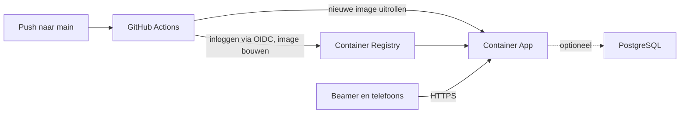

# Online zetten (Azure)

Deze handleiding is voor iedereen die een eigen installatie van de game online wil zetten: je hebt de repository geforkt of gekloond en wilt dat beamer en telefoons hem via een HTTPS-adres bereiken, ook op mobiele data. Je richt Azure en GitHub één keer in. Daarna werkt elke push naar `main` de installatie vanzelf bij.

Voor ontwikkelen en testen op je eigen computer, zie [Lokaal draaien en testen](local.md).

In de voorbeelden staan waarden die je zelf kiest tussen punthaken, zoals `<resource-group>`. Vervang ze inclusief de haken.

## Overzicht



| Onderdeel | Dienst | Wat het doet |
| --- | --- | --- |
| Broncode en pipeline | GitHub en GitHub Actions | Test de code, bouwt de Docker-image en rolt hem uit. |
| Images | Azure Container Registry | Bewaart elke gebouwde image, met de commit als tag. |
| De game | Azure Container Apps | Draait één container: nginx met de website, en daarachter de game-API. |
| Sessies (optioneel) | Azure Database for PostgreSQL | Alleen als je `enablePostgres=true` zet. Standaard uit: sessies leven alleen in het geheugen en verdwijnen bij herstart of deploy. |
| Logboek | Log Analytics | Bewaart de logregels van de container 30 dagen. |

Website en API zitten in dezelfde container en delen één adres. De API houdt alle sessies in het geheugen van één proces; daarom draait er altijd precies één container. De game is bedoeld voor een paar gelijktijdige spellen, niet voor hoge beschikbaarheid.

## Wat je nodig hebt

- Een GitHub-repository met de code (een fork of een eigen kopie) met de branch `main`, en beheerrechten op die repository om variabelen in te stellen.
- Een Azure-abonnement. Op de resource group heb je de rol **Owner** nodig, of **Contributor** samen met **Role Based Access Control Administrator**: de uitrol kent rollen toe.
- De [Azure CLI](https://learn.microsoft.com/cli/azure/install-azure-cli) (`az`), op je eigen computer of in [Azure Cloud Shell](https://shell.azure.com). Bicep installeert de CLI zelf bij het eerste gebruik.
- Een kloon van je repository op de plek waar je `az` gebruikt, want de uitrol leest `infra/main.bicep`.

Docker heb je voor Azure niet nodig: de pipeline bouwt de image.

## Waar stel je wat in

| Wat | Waar | Hoe |
| --- | --- | --- |
| Azure-resources | Eén resource group in je abonnement | Eenmalig met `az deployment group create` en [`infra/main.bicep`](../infra/main.bicep) (stap 3). |
| Geheimen: `AUTH_SECRET`, `INTERNAL_TICK_SECRET`, en optioneel `DATABASE_URL` | Secrets van de Container App | Je geeft ze als parameter mee bij de uitrol; het template zet ze op de app. Ze staan niet in de repository en niet in GitHub. |
| Overige instellingen van de game | Omgevingsvariabelen van de Container App | Het template zet `NODE_ENV=production` en `ALLOW_DEV_AUTH=true`. Extra variabelen zet je met `az containerapp update` (zie [Beheer](#beheer)). |
| Wie mag deployen | Managed identity `<namePrefix>-deploy` in de resource group | Het template maakt hem aan en vertrouwt alleen de branch `main` van jouw repository. |
| Koppeling GitHub naar Azure | GitHub: **Settings → Secrets and variables → Actions → Variables** | Zes variabelen die je overneemt uit de uitvoer van de uitrol (stap 4). |
| Wat de pipeline doet | [`.github/workflows/deploy.yml`](../.github/workflows/deploy.yml) | Staat in de repository; aanpassen hoeft niet. |
| Publiek adres | Ingress van de Container App | Azure geeft een adres met HTTPS. Een eigen domein koppel je later in het portaal (zie [Eigen domein](#eigen-domein)). |
| Postgres aan of uit | Parameter `enablePostgres` bij de Bicep-uitrol | Standaard `false`. Zet `enablePostgres=true` (plus `postgresAdminPassword`) als sessies een herstart moeten overleven. |

GitHub bewaart geen wachtwoord of sleutel van Azure. De pipeline logt in met OpenID Connect (OIDC): GitHub geeft per run een kortlevend bewijs af, en Azure accepteert dat alleen voor jouw repository en branch.

## Eenmalige inrichting

De commando's staan in bash, zoals in Azure Cloud Shell en op macOS en Linux. Waar PowerShell afwijkt, staat de PowerShell-variant erbij. Voer ze uit in de hoofdmap van je kloon.

### 1. Repository klaarzetten

Zorg dat de code op GitHub staat en dat `main` de branch is die online moet. Noteer eigenaar en naam uit het adres van de repository: bij `https://github.com/<github-owner>/<repo>` is dat `<github-owner>/<repo>`, met exact dezelfde hoofdletters.

Bij een fork staan workflows eerst uit. Open het tabblad **Actions** en zet ze aan.

### 2. Aanmelden en een resource group maken

```bash
az login
az account set --subscription <subscription-id>
az group create --name <resource-group> --location <region>
```

Kies een regio dicht bij je spelers, bijvoorbeeld `westeurope`. Gebruik bij voorkeur een resource group die alleen voor deze game is: dan kun je later alles in één keer verwijderen. Een bestaande resource group mag ook; de pipeline krijgt alleen rechten op de resources van de game, niet op de rest van de groep.

Een nieuw abonnement kent de gebruikte diensten soms nog niet. Registreer ze één keer; dat mag gerust dubbel:

```bash
for ns in Microsoft.App Microsoft.ContainerRegistry Microsoft.DBforPostgreSQL Microsoft.OperationalInsights Microsoft.ManagedIdentity; do
  az provider register --namespace $ns --wait
done
```

```powershell
foreach ($ns in 'Microsoft.App', 'Microsoft.ContainerRegistry', 'Microsoft.DBforPostgreSQL', 'Microsoft.OperationalInsights', 'Microsoft.ManagedIdentity') {
  az provider register --namespace $ns --wait
}
```

### 3. Infrastructuur uitrollen

Dit commando maakt de Azure-resources aan **zonder** Postgres (standaard) en genereert de sleutels voor identiteitstokens en het interne tick-endpoint. Sessies leven dan alleen in het geheugen van de container: goedkoop, maar weg na elke herstart of deploy. Wil je sessies bewaren, voeg dan `enablePostgres=true` en een databasewachtwoord toe (zie hieronder).

```bash
az deployment group create \
  --resource-group <resource-group> \
  --name bdi-games \
  --template-file infra/main.bicep \
  --parameters githubRepository=<github-owner>/<repo> \
               authSecret="$(openssl rand -base64 48)" \
               internalTickSecret="$(openssl rand -base64 48)" \
  --query properties.outputs
```

```powershell
function New-Secret([int]$bytes) {
  $buffer = New-Object byte[] $bytes
  [Security.Cryptography.RandomNumberGenerator]::Create().GetBytes($buffer)
  [Convert]::ToBase64String($buffer)
}

az deployment group create `
  --resource-group <resource-group> `
  --name bdi-games `
  --template-file infra/main.bicep `
  --parameters githubRepository=<github-owner>/<repo> `
    authSecret="$(New-Secret 48)" `
    internalTickSecret="$(New-Secret 48)" `
  --query properties.outputs
```

**Met Postgres** (sessies overleven herstart en deploy; duurder, uitrol duurt langer):

```bash
az deployment group create \
  --resource-group <resource-group> \
  --name bdi-games \
  --template-file infra/main.bicep \
  --parameters githubRepository=<github-owner>/<repo> \
               enablePostgres=true \
               postgresAdminPassword="$(openssl rand -base64 32)" \
               authSecret="$(openssl rand -base64 48)" \
               internalTickSecret="$(openssl rand -base64 48)" \
  --query properties.outputs
```

Zonder Postgres duurt de uitrol een paar minuten; met Postgres ongeveer tien. Je hoeft de geheimen niet te bewaren: de game leest ze van de Container App, en daar kun je ze later ook terugvinden (zie [Infrastructuur opnieuw uitrollen](#infrastructuur-opnieuw-uitrollen)).

Aan het eind verschijnt de uitvoer. Die heb je in stap 4 en 6 nodig. Later opvragen kan met:

```bash
az deployment group show --resource-group <resource-group> --name bdi-games --query properties.outputs
```

De overige parameters, zoals `namePrefix` en `postgresLocation`, staan in [infra/README.md](../infra/README.md).

Tot de eerste deploy draait de Container App een tijdelijke voorbeeldimage van Microsoft. Die kan de game niet vervangen, dus het adres geeft dan een foutmelding. Dat is verwacht en verdwijnt bij stap 5.

### 4. GitHub aan Azure koppelen

Open in je repository **Settings → Secrets and variables → Actions**, kies het tabblad **Variables** en maak met **New repository variable** deze zes variabelen aan. Naam en waarde neem je over uit de uitvoer van stap 3.

| Variabele | Waarde |
| --- | --- |
| `AZURE_CLIENT_ID` | Client-id van de identiteit waarmee de pipeline inlogt. |
| `AZURE_TENANT_ID` | Id van je Azure-tenant. |
| `AZURE_SUBSCRIPTION_ID` | Id van je abonnement. |
| `AZURE_RESOURCE_GROUP` | Naam van de resource group. |
| `AZURE_CONTAINER_REGISTRY` | Naam van de registry, zonder `.azurecr.io`. |
| `AZURE_CONTAINER_APP` | Naam van de Container App. |

Het zijn identificaties, geen geheimen. Zet ze onder **Variables** en niet onder **Secrets**: de workflow leest alleen variabelen. Met de GitHub CLI kan het ook: `gh variable set AZURE_CLIENT_ID --body <waarde>`.

### 5. Eerste deploy

Open het tabblad **Actions**, kies de workflow **Deploy** en klik **Run workflow** op de branch `main`. Een push naar `main` heeft hetzelfde effect.

De workflow doet twee dingen na elkaar:

1. **verify**: installeert de afhankelijkheden en draait `npm run typecheck`, `npm test` en `npm run check:bundle`.
2. **deploy**: logt in bij Azure, bouwt de Docker-image, zet hem in de registry met de tags `<commit>` en `latest`, laat de Container App die image draaien en wacht tot de nieuwe versie gezond is.

Slaagt de run, dan staat het adres van de game in de samenvatting van de run.

### 6. Controleren

1. Open `<appUrl>/health`, met `appUrl` uit de uitvoer van stap 3. Je hoort `{"ok":true,"openStreams":0}` te zien.
2. Open `<appUrl>` op de beamer, kies een spel en daarna **Nieuw spel**.
3. Scan een QR-code met een telefoon op mobiele data en neem een rol.
4. Speel een paar stappen, herlaad de telefoon en controleer dat die weer op dezelfde plek zit.

## Daarna: elke push naar main

Elke push naar `main` start dezelfde workflow en zet de nieuwe versie online. Je hoeft daarvoor niets meer in Azure te doen.

- Een push die alleen documentatie wijzigt (`docs/` of `.md`-bestanden) start geen deploy.
- Bij een pull request draait alleen **verify**. Dat geldt ook voor een fork zonder de zes variabelen.
- Mislukt **verify** of wordt de nieuwe versie niet gezond, dan blijft de vorige versie draaien en is de run rood.

**Deploy niet tijdens een spel.** Azure start de nieuwe container voordat de oude stopt. Verbindingen van beamer en telefoons vallen kort weg en herstellen vanzelf. Zonder Postgres verdwijnen alle sessies. Met Postgres komen ze terug uit de database, maar de voortgang van de laatste tientallen seconden kan verloren gaan.

## Beheer

### Gebruik

- **Oude sessies.** Een sessie vervalt na `SESSION_TTL_HOURS` (standaard 24 uur). Daarnaast sluit en verwijdert de API sessies na `SESSION_IDLE_MS` zonder activiteit (standaard 30 minuten; heartbeats van telefoons tellen als activiteit).
- **Limiet per netwerk.** Per client-IP staan maximaal `MAX_OPEN_SESSIONS_PER_IP` open spellen toe (standaard 10; `0` zet de limiet uit). Daarboven krijg je HTTP 429 tot er een spel eindigt of wordt opgeruimd.
- **Herstart.** Azure kan de container herstarten, bijvoorbeeld voor onderhoud. Zonder Postgres zijn alle sessies dan weg. Met Postgres schrijft de API eerst naar de database en laadt hij ze bij het opstarten weer in.

### Instellingen wijzigen

Alle variabelen staan met uitleg in [`.env.example`](../.env.example). Zet er een op de Container App met:

```bash
az containerapp update --name <container-app> --resource-group <resource-group> \
  --set-env-vars PRESENTATION_MS=1500
```

De app herstart daarna met de nieuwe waarde. Een deploy van de pipeline laat deze variabelen staan. Rol je het template opnieuw uit, dan vervallen ze; zet ze dan opnieuw of neem ze op in `infra/main.bicep`.

`VITE_*`-variabelen en `CORS_ORIGIN` heb je niet nodig: website en API delen één adres. `PORT` en `LISTEN_HOST` zet de container zelf.

### Logboek bekijken

```bash
az containerapp logs show --name <container-app> --resource-group <resource-group> --follow
```

Regels die met `[bdi]` beginnen komen van de API: `sse.open` en `sse.close` (verbindingen van beamer en telefoons, met het aantal open stromen), `session.create`, `session.start`, `session.claim`, `access.action` en `http.error`. Heartbeats en ticks worden niet gelogd; geslaagde HTTP-verzoeken alleen met `LOG_HTTP=all`. Oudere regels vind je in het Azure-portaal bij de Container App onder **Monitoring → Logs**.

### Terug naar een eerdere versie

Elke image heeft de commit als tag. Laat de app een eerdere draaien met:

```bash
az containerapp update --name <container-app> --resource-group <resource-group> \
  --image <registry>.azurecr.io/bdi-games:<commit>
```

De volgende push naar `main` zet weer de nieuwste versie online; herstel dus ook de code.

### Infrastructuur opnieuw uitrollen

Rol het template opnieuw uit als je `infra/main.bicep` hebt aangepast, een geheim wilt vervangen, of de repository een andere naam of eigenaar heeft gekregen. Geef dan altijd `imageTag=latest` mee. Zonder die parameter zet het template de tijdelijke voorbeeldimage terug en ligt de game plat tot de volgende deploy.

Dit voorbeeld behoudt de bestaande sleutels. Zonder Postgres:

```bash
az deployment group create \
  --resource-group <resource-group> \
  --name bdi-games \
  --template-file infra/main.bicep \
  --parameters githubRepository=<github-owner>/<repo> imageTag=latest \
               authSecret="$(az containerapp secret show --name <container-app> --resource-group <resource-group> --secret-name auth-secret --query value --output tsv)" \
               internalTickSecret="$(az containerapp secret show --name <container-app> --resource-group <resource-group> --secret-name internal-tick-secret --query value --output tsv)" \
  --query properties.outputs
```

Had je Postgres aanstaan, geef dan opnieuw `enablePostgres=true` mee en een `postgresAdminPassword` (nieuw of het bestaande). Zonder die parameter blijft Postgres uit en verdwijnt een eerder aangemaakte database niet vanzelf — verwijder die handmatig als je hem niet meer wilt.

Vervang `authSecret` alleen als het moet, bijvoorbeeld na een lek. Browsers bewaren een identiteit die met die sleutel is ondertekend. Na een nieuwe sleutel is die ongeldig en meldt de game "Ongeldige identiteit" tot je de sitegegevens van die browser wist.

### Oude images opruimen

Elke deploy voegt een image toe. De registry heeft ruimte voor veel versies, maar opruimen kan zo: dit bewaart de vijf nieuwste en verwijdert wat ouder is dan dertig dagen.

```bash
az acr run --registry <registry> \
  --cmd "acr purge --filter 'bdi-games:.*' --ago 30d --keep 5 --untagged" /dev/null
```

### Eigen domein

Azure geeft standaard een adres als `https://<app>.<regio>.azurecontainerapps.io`. Een eigen naam (bijvoorbeeld `https://game.voorbeeld.nl`) is optioneel en koppel je in het portaal; het Bicep-template doet dat niet automatisch (DNS-validatie vraagt handmatige stappen).

1. Koop of kies een domein bij je registrar.
2. Open in het Azure-portaal de Container App → **Custom domains** → **Add custom domain**.
3. Volg de DNS-records die Azure toont (meestal een CNAME of TXT). Zet die bij je registrar.
4. Kies een **managed certificate** zodat HTTPS werkt zonder eigen certificaat te uploaden.
5. Open daarna de game op het nieuwe adres. De QR-codes volgen vanzelf het adres waarop de beamer de pagina opent; je hoeft geen `VITE_*`-variabele te zetten.

Details: [Custom domains and managed certificates](https://learn.microsoft.com/azure/container-apps/custom-domains-managed-certificates). De optionele Bicep-parameter `customDomain` is alleen een hint in de uitvoer; hij wijzigt geen resources.

### Alles verwijderen

```bash
az group delete --name <resource-group>
```

Dit verwijdert alle resources en daarmee alle kosten en alle opgeslagen sessies. Verwijder daarna de zes variabelen in GitHub; zonder die variabelen slaat de workflow de deploy over.

## Kosten en schaal

De installatie staat altijd aan. Zonder Postgres (standaard) komen de kosten vooral van de container (0,25 vCPU en 0,5 GiB, doorlopend); de registry (Basic) en het logboek zijn kleine posten. Met Postgres (`enablePostgres=true`, Burstable B1ms, 32 GB) wordt de database meestal de grootste post. Reken zonder database op een lager bedrag per maand, met database op enkele tientjes. Prijzen verschillen per regio en veranderen; reken het na met de [Azure-prijscalculator](https://azure.microsoft.com/pricing/calculator/).

Met Postgres bundelt de API schrijfacties (`PERSIST_INTERVAL_MS`, standaard elke 15 seconden) en ruimt verlaten sessies op. nginx schrijft geen toegangslog. Een stilstaande installatie veroorzaakt daardoor nauwelijks verkeer of logvolume.

Er draait precies één container en dat hoort zo: de API is niet gemaakt voor meerdere exemplaren naast elkaar. Verhoog het aantal replica's niet. Heb je meer rekenkracht nodig, vergroot dan `cpu` en `memory` in `infra/main.bicep`.

## Beveiliging in het kort

- Er staan geen geheimen in de repository en geen Azure-wachtwoord in GitHub; de pipeline logt in via OIDC en alleen vanaf `main`.
- De pipeline heeft de rol Contributor alleen op de resources van de game (Container App, omgeving, registry en pull-identity), niet op de rest van de resource group, en kan geen rollen toekennen.
- De Container App haalt images op met een eigen identiteit; de registry heeft geen beheerderswachtwoord.
- De game is alleen via HTTPS bereikbaar. Alleen de website, `/api` en `/health` zijn publiek; het interne tick-endpoint niet.
- De container draait niet als root.
- Met Postgres eist de database TLS, controleert de API het certificaat (`sslmode=verify-full`), en laat de firewall alleen verbindingen toe die binnen Azure ontstaan.

## Problemen oplossen

**Uitrol van de infrastructuur**

- **`MissingSubscriptionRegistration`**: een dienst is nog niet geregistreerd in je abonnement. Voer de registratie uit stap 2 uit. Heb je daar geen rechten voor, vraag het de beheerder van het abonnement.
- **`AuthorizationFailed` bij `roleAssignments/write`**: je mag geen rollen toekennen. Je hebt Owner nodig op de resource group, of Contributor samen met Role Based Access Control Administrator.
- **De regio is niet beschikbaar voor PostgreSQL** (bijvoorbeeld `LocationIsOfferRestricted`): sommige abonnementen mogen in bepaalde regio's geen database aanmaken. Voeg `postgresLocation=<andere-regio>` toe aan de parameters, bijvoorbeeld `northeurope`.
- **Een naam is al in gebruik of ongeldig**: kies een ander voorvoegsel met `namePrefix=<voorvoegsel>` (3 tot 12 kleine letters en cijfers).

**Pipeline**

- **De job deploy wordt overgeslagen**: de variabele `AZURE_CLIENT_ID` ontbreekt, staat onder Secrets in plaats van Variables, of de run draait niet op `main`.
- **Inloggen mislukt met "No matching federated identity record found"**: Azure vertrouwt alleen `<github-owner>/<repo>` op de branch uit stap 3. Controleer hoofdletters, en of de repository is hernoemd of verplaatst. Rol het template opnieuw uit met de juiste `githubRepository` (en eventueel `githubBranch`).
- **Dezelfde fout, met een subject als `repo:<github-owner>@<getal>/<repo>@<getal>:ref:refs/heads/main`**: je organisatie laat GitHub id's in het subject zetten. Rol het template opnieuw uit met daarbij `githubRepositoryWithIds=<github-owner>@<getal>/<repo>@<getal>`, overgenomen uit de foutmelding.
- **Geen toegang tot de registry of de Container App vlak na stap 3**: een nieuwe roltoewijzing werkt soms pas na een paar minuten. Start de run opnieuw.
- **"The new revision did not become healthy"**: de container start niet goed. Bekijk het logboek (zie [Logboek bekijken](#logboek-bekijken)). Veelvoorkomend:
  - `AUTH_SECRET ontbreekt`: het secret `auth-secret` is leeg of de variabele is verwijderd. Rol het template opnieuw uit.
  - `password authentication failed` of een time-out naar de database: wachtwoord en `DATABASE_URL` lopen niet meer gelijk, of de firewallregel is verwijderd. Rol het template opnieuw uit.

**Na de deploy**

- **Het adres geeft een fout vóór de eerste deploy**: de tijdelijke voorbeeldimage draait nog. Voer stap 5 uit.
- **De game meldt "Ongeldige identiteit"**: `authSecret` is vervangen. Wis de sitegegevens van de browser.
- **Beamer of telefoon toont kort "opnieuw verbinden"**: de container is herstart, bijvoorbeeld door een deploy. De verbinding herstelt vanzelf.
- **HTTP 429 bij Nieuw spel**: er staan al tien spellen open vanaf jouw netwerk. Beëindig er een, wacht tot verlaten spellen zijn opgeruimd, of pas `MAX_OPEN_SESSIONS_PER_IP` aan.
